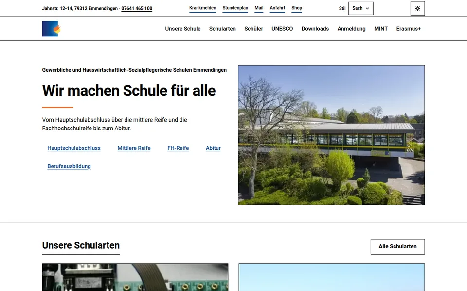

# GHSE – Variante „funktional“

Interne Kennung `funktional` (kein sichtbarer Markenname; im Umschalter
steht „Funktional“). Dritte Gestaltung derselben Seiten: konsequenter
funktionaler Minimalismus mit den klassischen Tugenden des Web – klare
Navigation, lesbare Texte, sichtbare Ordnung – auf aktuellem Niveau.

**Hallmark-Referenz:** Almanac (Referenz/Handbuch: Hanken Grotesk, zwei
Linienstärken, eckige Kanten, Tabellen). Übernommen werden Struktur und
Typografie; die Palette bleibt strikt GHSE-Schwarz/Weiß/Logo.

## 1. Prinzip

Weiß ist die Grundfläche. Schwarz trägt Typografie, Linien und Struktur.
Gelb, Orange und Blau aus dem GHSE-Logo erscheinen nur als gezielte Akzente:
blaue Links und aktive Navigation, gelbe Marken, orange Unterstreichungen und
Kanten, blaue Trennlinien. Kein Grau als Designfarbe, keine Verläufe, keine
Schatten, keine Rundungen, keine Schrägstellung, keine Versalien.

Die Seite soll wie eine gut geführte Informationsseite wirken, nicht wie ein
Dashboard und nicht wie eine Werbe-Landingpage. Inhalte und Hierarchie stehen
vor Dekoration.

## 2. Tokens

Rohwerte stehen nur im Token-Block von `assets/css/funktional.css` (hell) und
in den beiden dunklen Sätzen. Alles Weitere benutzt Tokens.

| Rolle | Wert | Verwendung |
| --- | --- | --- |
| Papier | `#FFFFFF` | Grundfläche, Karten, Tabellen |
| Schrift | `#000000` | Fließtext, Überschriften, Linien, Ränder |
| GHSE-Blau | `#114C92` | Links, aktive Navigation, Fokus, blaue Kanten |
| GHSE-Gelb | `#F6DC56` | Marken, Tabellenkopf, kleine Flächen |
| GHSE-Orange | `#EE7330` | Unterstreichungen, Zitatkante, Warnung |

- **Schrift:** Hanken Grotesk (variabel, 400–700), selbst gehostet unter
  `assets/fonts/funktional/` (SIL OFL, `LIZENZ.txt`). Fließtext
  1,125 rem, Zeilenhöhe 1,65, Lesebreite 66 Zeichen.
- **Raster:** 4/8/12/16/24/32/48 px; Abschnitte `clamp(2rem, 4vw, 3.25rem)`.
- **Form:** Radius 0, Rahmen 1 px, keine Schatten. Einzige Linienstärken:
  1 px für Struktur, 2 px für aktive Unterstreichungen, 4 px für farbige
  Kanten an Karten, Fuß und Zitaten.
- **Dunkel:** schwarze Fläche, weiße Schrift und Linien; Links und Fokus in
  Gelb, Gelb/Orange/Blau bleiben Akzente. Der Fuß bleibt schwarz.

## 3. Komponenten

- **Kopf:** weiße Leiste mit schwarzer Unterkante; Logo, Schnellzugriffe,
  Stilwahl. Hauptnavigation schwarz, aktive Seite als blaue Fläche mit weißer
  Schrift. Unter 1200 px dasselbe Aufklappmenü wie in den anderen Varianten.
- **Hero:** weiße Fläche, kein großer Bildteppich. H1 2,9 rem, Leitsatz,
  Abschlüsse als einfache Textlinks mit blauer Unterstreichung, Foto rechts
  mit 1-px-Rahmen. Auf dem Telefon Text, Abschlüsse, Foto.
- **Sektionen:** H2 mit 2-px-Schwarzlinie; kein Kicker. Ruhige Abstände.
- **Karten:** weiße Fläche, 1-px-Rahmen, kein Radius, kein Schatten. Bild
  oben, Text, ein Textlink. Kategorie als gelbe Marke mit schwarzer Kontur.
- **Service und Kalender:** flache Kästen; Service trägt eine 4-px-Kante in
  Gelb, Orange oder Blau, Kalender bleiben neutral.
- **Sprungleiste:** die Kategorie-Chips der Download-Seite bleiben am
  Zeigegerät flach (14 px, 38 px hoch), damit die klebende Leiste in einer
  Zeile bleibt statt auf 170–226 px anzuwachsen; auf Touch und unter 640 px
  gilt weiter die volle Zielhöhe von 48 px. Ankersprünge landen unter Kopf
  und Leiste.
- **Knöpfe:** primär schwarz gefüllt, sekundär weiß mit schwarzer Kontur,
  0 Radius; Hover als Unterstreichung/Farbwechsel, kein Versatz.
- **Tabellen:** 1-px-Raster, gelber Kopf, schwarze Schrift; mobil kleinere
  Schrift und 8 px Polster.
- **Fuß:** weiße Fläche mit schwarzer Schrift und blauer Oberkante, Copyright
  in einer weißen Leiste mit schwarzer Trennlinie. Im Dunkeln dreht sich das
  Bild: schwarze Fläche, weiße Schrift, gelbe Links.

## 4. Zugänglichkeit

- Text und Links: Schwarz auf Weiß (21:1), Blau auf Weiß (8,5:1); Gelb nur
  als Fläche mit schwarzer Schrift (12,9:1), Orange nur als Linie/Kante.
- Fokus: 4-px-Ring in Blau mit 4 px Abstand, sofort sichtbar.
- Zeigeziele: mindestens 44 px; kleine Textlinks mit unsichtbar vergrößerter
  Fläche.
- Keine Information hängt an Farbe allein; aktive Navigation trägt zusätzlich
  `aria-current`.
- Keine Bewegung außer dem bestehenden Reduced-Motion-Verhalten.

## 5. Abgrenzung

Neu ist ausschließlich `assets/css/funktional.css` plus der Eintrag in
`params.designs` (dort als Variante ohne gespeicherte Wahl); alle Regeln sind
auf `:root[data-design="funktional"]` begrenzt. Die Varianten Neo und Klar bleiben unberührt. Die Datei wird auf
jeder Seite mitgeladen, wirkt aber nur bei aktiver Wahl.

## 6. QA

1. `python3 qa/themes.py` prüft alle vier Varianten (Datenattribute,
   Überlauf, Versalien, Rotation, Schriftgrößen, Kontraste, Zeigeziele).
2. `python3 qa/linkcheck.py` und `python3 qa/reflow.py` prüfen die Seiten.
3. Sichtprobe: Startseite, Downloads, Schulart-Detail, Meldung, 404; hell und
   dunkel; 1440, 1024, 768 und 390 px.
4. Regression: Neo und Klar müssen pixelgleich zum Referenzstand bleiben
   (siehe `qa/theme-guard.py`).
