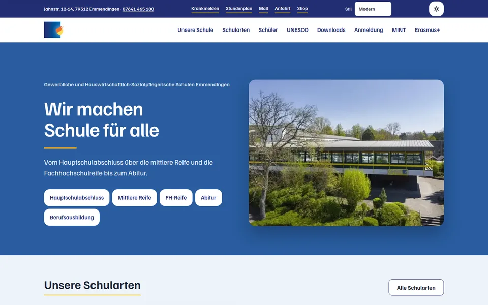

# GHSE – Variante „modern“

Interne Kennung `modern` (Kurzform im Umschalter: „Mod“). Vierte Gestaltung:
eine konsequente Weiterentwicklung des bestehenden GHSE-Auftritts
(www.ghse.de). Kein neuer Markenauftritt, sondern eine Modernisierung der
vorhandenen Identität.

## 1. Was bleibt

- Das offizielle GHSE-Logo und die Bildmarke.
- Die Farbwelt der bestehenden Website: Marineblau `#222D71`, GHSE-Blau
  `#295C9F`, Gelb `#F1DB6C`, Orange `#F8A000`, dazu Weiß und helle Blautöne.
- Die vertraute Informationsarchitektur, die authentischen Schulbilder und
  alle Inhalte und Funktionen.
- Die institutielle Wirkung: eine vielseitige berufliche Schule, nicht ein
  Technikbetrieb, Krankenhaus oder Softwareunternehmen.

## 2. Was modernisiert wird

- **Typografie:** Montserrat 400–700 für Text und Überschriften – die
  geometrische Stimme der bisherigen Website. Klare Größenstufen, ruhige
  Zeilenhöhen, 66 Zeichen Lesebreite.
- **Kopf:** marineblaue Nutzleiste, weiße Logozeile, klare Navigation mit
  blauer aktiver Fläche; mobil dasselbe zugängliche Aufklappmenü.
- **Hero:** großzügiges blaues Band mit weißer Typografie und gerundetem
  Schulbild; keine Überlagerung, kein Effekt, keine Schräglage.
- **Flächen:** helles Blau als Seitengrund, weiße Karten mit 16-px-Radius und
  weichem Schatten; Gelb und Orange als Marken und Kanten.
- **Komponenten:** einheitliche Karten, Zeilen, Kalender, Buttons und Links;
  klare Zustände, keine dekorativen Sprünge.
- **Fuß:** marineblau, gelbe Titel, weiße Links, gelbe Oberkante.

## 3. Tokens

| Rolle | Hell | Dunkel | Verwendung |
| --- | --- | --- | --- |
| Papier | `#EEF3FA` | `#0B1220` | Seitengrund |
| Fläche | `#FFFFFF` | `#111C33` | Karten, Zeilen, Kästen |
| Schrift | `#1A2233` | `#F2F6FF` | Text und Überschriften |
| Zweittext | `#4A5568` | `#C7D3E8` | Beschreibungen, Metadaten |
| Marine | `#222D71` | `#295C9F` | Kopfleiste, Fuß, aktive Elemente |
| Blau | `#295C9F` | `#295C9F` | Hero, blaue Bänder |
| Gelb | `#F1DB6C` | `#F1DB6C` | Titelstriche, Marken, Fußkante |
| Orange | `#F8A000` | `#F8A000` | Akzente, Hover-Kanten |
| Fokus | `#B85C00` | `#F8A000` | Fokusringe (≥ 3:1) |

- **Form:** Radius 16 px für Karten, 10 px für Buttons, 8 px für kleine
  Bedienelemente; weiche Schatten statt harter Versätze.
- **Schrift:** Montserrat (variabel, 400–700) für Text und Überschriften;
  selbst gehostet unter `assets/fonts/modern/` (SIL OFL, `LIZENZ.txt`),
  keine externen Font-Dienste.
- **Raster:** 8-pt-Nähe, Abschnitte `clamp(2.5rem, 5vw, 4rem)`.
- **Dunkel:** tiefes Marineblau, Karten heben sich mit dunkler Fläche und
  weichem Schatten; Gelb bleibt Marke, Blau bleibt Band.

## 4. Komponenten

- **Kopf:** Nutzleiste marineblau mit weißen Schnellzugriffen und Gelb als
  Unterstreichung; Logozeile weiß; aktive Navigation blau mit weißer Schrift.
- **Hero:** blaues Band, Montserrat-H1 in Weiß, Leitsatz, Abschlüsse als weiße
  Pillen, Foto rechts mit 20-px-Radius und weichem Schatten.
- **Karten:** weiß, 16 px Radius, 1-px-Rand, weicher Schatten; Bild oben,
  gelbe Kategorie-Marke, Titel, Text, Textlink.
- **Service/Kalender:** gleiche Kartenfamilie; Service trägt eine farbige
  Oberkante in Gelb, Orange oder Blau.
- **Knöpfe:** marineblau gefüllt oder weiß mit Marine-Kontur, Radius 10 px;
  Hover über Farbe/Rand, ohne Versatz.
- **Links:** Marineblau, Unterstreichung in Orange.
- **Tabellen:** helle Raster, marineblauer Kopf mit weißer Schrift.
- **Fuß:** marineblau, gelbe Spaltentitel, weiße Links, 4-px-Gelbkante.

## 5. Zugänglichkeit

- Text: `#1A2233` auf Weiß (ca. 15:1), Weiß auf Marine (ca. 10,5:1),
  Weiß auf Hero-Blau (ca. 5,8:1 – AA für Fließtext, AAA für große Schrift).
- Fokus: 4-px-Ring in `#B85C00` hell, `#F8A000` dunkel; nicht vom Kopf
  verdeckt.
- Zeigeziele mindestens 44 px; kleine Textlinks mit vergrößerter Fläche.
- Bilder mit Alternativtexten; keine Information nur über Farbe.
- Keine automatische Bewegung; Reduced Motion bleibt respektiert.

## 6. Abgrenzung

Neu sind `assets/css/modern.css` und ein Eintrag in `params.designs`; alle
Regeln sind auf `:root[data-design="modern"]` begrenzt. Die bestehenden
Varianten Neo und Klar werden weder gestalterisch noch funktional verändert.
Die Datei wird auf jeder Seite mitgeladen, wirkt aber nur bei aktiver Wahl.

## 7. QA

1. `python3 qa/themes.py` prüft alle vier Varianten.
2. `python3 qa/linkcheck.py`, `qa/reflow.py`, `qa/layout.py`.
3. Sichtprobe: Startseite, Downloads, Schulart-Detail, Meldung, 404; hell und
   dunkel; 1440, 1024, 768 und 390 px.
4. Regression: Neo und Klar pixelgleich zum Referenzstand.
